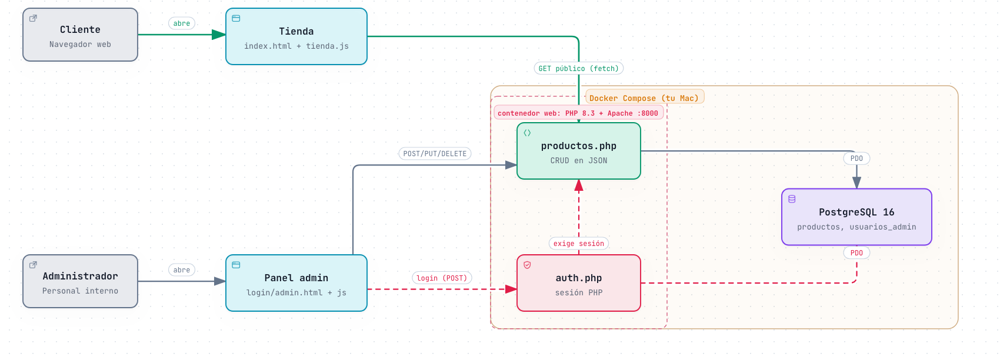

# Frescos del Día

Tienda de productos perecederos con panel administrativo (CRUD).
Stack: PHP 8.3 + Apache, PostgreSQL 16, HTML5, CSS3 y JavaScript, todo con Docker.

## Cómo ejecutarlo

Requisito: Docker Desktop encendido.

```bash
docker compose up -d --build
```

| Qué | Dónde |
|---|---|
| Tienda (cliente) | http://localhost:8000 |
| Login administrador | http://localhost:8000/login.html |
| PostgreSQL (DBeaver/psql) | `localhost:5434`, base `tienda_perecederos`, usuario y clave `postgres` |

Usuario administrador de prueba: `admin` / `Admin123!` (solo para el taller).

Para apagar: `docker compose down`. Para reiniciar la base desde cero (vuelve a cargar `sql/database.sql`): `docker compose down -v`.

## Arquitectura



Versión interactiva: [`docs/arquitectura.html`](docs/arquitectura.html) (descárgala y ábrela en el navegador).

```
Navegador ── fetch (JSON) ──> PHP + Apache (contenedor web) ── PDO ──> PostgreSQL (contenedor db)
```

- JavaScript corre en el navegador, PHP procesa las solicitudes en el servidor y PostgreSQL guarda los datos.
- `GET api/productos.php` es público y no devuelve productos vencidos.
- `POST`, `PUT` y `DELETE` exigen sesión PHP; sin ella responden `403`.
- Acceso a datos con PDO y sentencias preparadas (previene inyección SQL).

## Estructura

```
├── docker-compose.yml · Dockerfile
├── sql/database.sql         Tablas productos y usuarios_admin + datos de prueba
├── api/                     conexion.php · auth.php · productos.php
├── css/estilos.css
├── js/                      tienda.js · login.js · admin.js
└── index.html · login.html · admin.html
```

## Flujo de trabajo

`main` está protegida: los cambios entran por rama y Pull Request.
